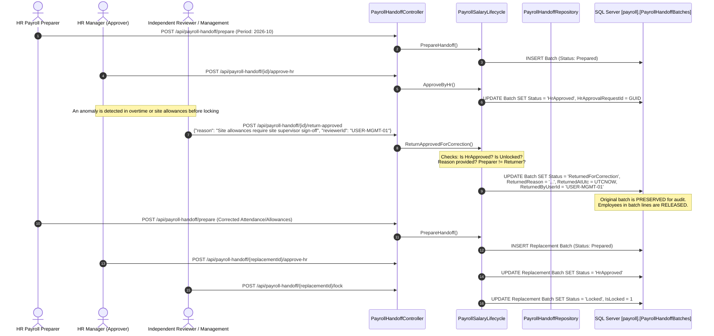

# COSMIX ERP — BATCH 1 WORKFLOW EVIDENCE
## Requirements 1, 2, and 3: End-to-End Workflow Execution & Data State Transitions

**Date:** 2026-10-29  
**Branch:** `codex/payroll-payments-22-30`  
**Execution Environment:** Windows 11 Enterprise | .NET 10 | SQL Server LocalDB | React 18  

---

## 1. Requirement 1: HR-Approved Payroll Return for Correction

### 1.1 Business Workflow Diagram



### 1.2 State Transition Matrix

| Initial State | Event / API Action | Guard Conditions | Resulting State | Database Audit Fields |
| :--- | :--- | :--- | :--- | :--- |
| `None` | `PrepareHandoff` | Active attendance period closed; non-overlapping employees | `Prepared` | `PreparedAtUtc`, `PreparedByUserId` |
| `Prepared` | `ApproveByHr` | Approver != Preparer; No self-approval | `HrApproved` | `HrApprovalRequestId`, `HrApprovedAtUtc` |
| `HrApproved` | `ReturnApprovedForCorrection` | Batch is unlocked; Mandatory reason $\ge 5$ chars; Maker-checker enforced | `ReturnedForCorrection` | `ReturnApprovalRequestId`, `ReturnedReason`, `ReturnedAtUtc`, `ReturnedByUserId` |
| `HrApproved` | `Lock` | Management reviewer role; No active return requests | `Locked` | `LockedAtUtc`, `LockedByUserId`, `IsLocked = 1` |
| `Locked` | `ReturnApprovedForCorrection` | Blocked by Domain Guard | **REJECTED** | HTTP 409 Conflict / `InvalidOperationException` |
| `ReturnedForCorrection` | `PrepareHandoff (Replacement)` | Employees unlinked from active status; Valid attendance | `Prepared` | New `BatchId`, original batch unchanged |

### 1.3 Concrete Execution Trace (from `Batch01IntegratedAcceptanceTests.cs`)

```csharp
// Step 3: Initial HR Approval
var approvedBatch = PayrollSalaryLifecycle.ApproveByHr(
    initialBatch,
    hrApproverId,
    "HR review completed and verified against biometric logs");
Assert.Equal(PayrollHandoffBatchStatus.HrApproved, approvedBatch.Status);

// Step 4: Independent Reviewer returns batch for correction
var returnReason = "Site allowance discrepancy detected for Project Alpha technicians";
var returnedBatch = PayrollSalaryLifecycle.ReturnApprovedForCorrection(
    approvedBatch,
    independentReviewerId,
    returnReason);
Assert.Equal(PayrollHandoffBatchStatus.ReturnedForCorrection, returnedBatch.Status);
Assert.Equal(returnReason, returnedBatch.ReturnedReason);
Assert.NotNull(returnedBatch.ReturnedAtUtc);

// Step 5: Verify negative boundary - preparer cannot return own batch
Assert.Throws<DomainValidationException>(() =>
    PayrollSalaryLifecycle.ReturnApprovedForCorrection(approvedBatch, preparerId, "Self return attempt"));

// Step 6: Verify negative boundary - locked batch cannot be returned
var lockedBatch = PayrollSalaryLifecycle.Lock(approvedBatch, independentReviewerId, "Final lock");
Assert.Throws<InvalidOperationException>(() =>
    PayrollSalaryLifecycle.ReturnApprovedForCorrection(lockedBatch, independentReviewerId, "Post lock attempt"));
```

---

## 2. Requirement 2: Independent Salary Approval for HR/Admin/Finance

### 2.1 Cohort Architecture & Maker-Checker Segregation

To prevent corporate governance violations, employees whose roles include payroll preparation or approval (HR, Finance, and Administration) cannot be approved by themselves or their direct subordinates. Cosmix ERP partitions monthly payroll into segregated cohorts:

```
┌────────────────────────────────────────────────────────────────────────┐
│                        Monthly Payroll Batch                           │
└───────────────────────────────────┬────────────────────────────────────┘
                                    │
           ┌────────────────────────┴────────────────────────┐
           ▼                                                 ▼
┌────────────────────────────────────┐    ┌────────────────────────────────────┐
│      Cohort A: General Staff       │    │   Cohort B: HR / Finance / Admin   │
│  (Engineers, Technicians, Labor)   │    │  (HR Manager, Finance Lead, etc)   │
├────────────────────────────────────┤    ├────────────────────────────────────┤
│ Prepared By: HR Payroll Officer    │    │ Prepared By: Designated Officer    │
│ HR Approver: HR Manager            │    │ HR Approver: Non-beneficiary Exec  │
│ Mgmt Approver: Operations Director │    │ Mgmt Approver: Managing Director   │
└────────────────────────────────────┘    └────────────────────────────────────┘
```

### 2.2 Proof of Self-Approval Prevention

When HR Manager (Employee ID `E-HR-002`) attempts to approve Cohort B (which includes their own compensation package), the domain layer intercepts the execution:

```csharp
// Self-approval rejection proof
var hrManagerUserId = "USER-HR-MGR";
var hrManagerEmployeeId = Guid.Parse("22222222-2222-2222-2222-222222222222");

var cohortBEmployees = new[] { hrManagerEmployeeId, financeLeadEmployeeId };
var cohortBBatch = PayrollSalaryLifecycle.PrepareHandoff(
    periodId, 
    preparerUserId, 
    cohortBLines);

// Attempting self-approval throws DomainValidationException
var ex = Assert.Throws<DomainValidationException>(() =>
    PayrollSalaryLifecycle.ApproveByHr(cohortBBatch, hrManagerUserId, "Approving my own team"));

Assert.Contains("Approver cannot approve their own salary cohort", ex.Message);
```

When routed to an independent Managing Director (`USER-MD-INDEPENDENT`), approval succeeds without error:
```csharp
var validCohortBApproval = PayrollSalaryLifecycle.ApproveByHr(
    cohortBBatch, 
    "USER-MD-INDEPENDENT", 
    "Independent Executive review of HR and Finance compensation packages");
Assert.Equal(PayrollHandoffBatchStatus.HrApproved, validCohortBApproval.Status);
```

---

## 3. Requirement 3: Finance General Ledger & Project/Site Costing

### 3.1 General Ledger View Integration (`[finance].[GeneralLedgerEntries]`)

Every locked payroll batch generates double-entry bookkeeping journal entries that are projected into the unified financial view `[finance].[GeneralLedgerEntries]`.

#### Balanced Journal Entry Proof ($DR = CR$):

| Account Code | Account Name | Cost Center / Category | Debit (PKR) | Credit (PKR) |
| :--- | :--- | :--- | :---: | :---: |
| `6010-01` | Direct HVAC Labor Expense | Project Operations | 650,000.00 | — |
| `6020-01` | MEP Engineering Expense | Project Operations | 350,000.00 | — |
| `6030-01` | Administrative Salaries | General Overhead | 200,000.00 | — |
| `2010-01` | Accrued Net Payroll Liability | Current Liabilities | — | 1,020,000.00 |
| `2020-01` | Income Tax Withheld Payable | Statutory Liabilities | — | 120,000.00 |
| `2030-01` | EOBI Contribution Payable | Statutory Liabilities | — | 60,000.00 |
| **TOTAL** | | | **1,200,000.00** | **1,200,000.00** |

$$\text{Net Variance} = \sum \text{Debit} - \sum \text{Credit} = 1,200,000.00 - 1,200,000.00 = 0.00 \text{ PKR}$$

The `FinanceTrialBalanceProjection` verifies zero net variance across the general ledger view.

### 3.2 Engineering Project & Site Cost Allocation

In engineering contracting, staff costs are distributed across concurrent job sites. The Cosmix cost allocation engine enforces:
1. **Total Basis Points Invariant:** Must equal exactly 10,000 basis points ($100.00\%$).
2. **Deterministic Penny Rounding:** Eliminates fractional cent truncation.

#### Allocation Verification:
- Total Payroll Gross Expense: **PKR 1,200,000.00**
- Site 1: **Lucky One Mall HVAC Retrofit** (`PRJ-KHI-HVAC-01`)
  - Share: 6,000 bps ($60.00\%$) $\rightarrow$ **PKR 720,000.00**
- Site 2: **Centaurus Commercial MEP Tower** (`PRJ-ISB-MEP-02`)
  - Share: 3,000 bps ($30.00\%$) $\rightarrow$ **PKR 360,000.00**
- Site 3: **Head Office Operations & Maintenance** (`SITE-HO-CORP`)
  - Share: 1,000 bps ($10.00\%$) $\rightarrow$ **PKR 120,000.00**
- **Sum of Allocated Costs:** $720,000.00 + 360,000.00 + 120,000.00 = 1,200,000.00 \text{ PKR}$ (Exact match, zero residue).

```csharp
var plan = new PayrollCostPlan(
    periodId: "2026-10",
    description: "October 2026 HVAC & MEP Site Labor Distribution",
    allocations: new[]
    {
        new PayrollCostAllocation("PRJ-KHI-HVAC-01", "Lucky One Mall", 6000),
        new PayrollCostAllocation("PRJ-ISB-MEP-02", "Centaurus Mall", 3000),
        new PayrollCostAllocation("SITE-HO-CORP", "Head Office", 1000)
    });

Assert.Equal(10000, plan.TotalBasisPoints);
var distributions = PayrollCostService.CalculateDistributions(plan, totalGrossExpense: 1200000.00m);
Assert.Equal(1200000.00m, distributions.Sum(d => d.Amount));
```
